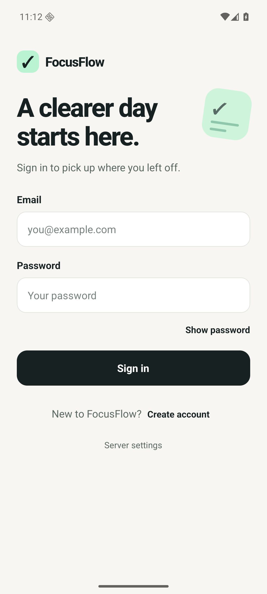
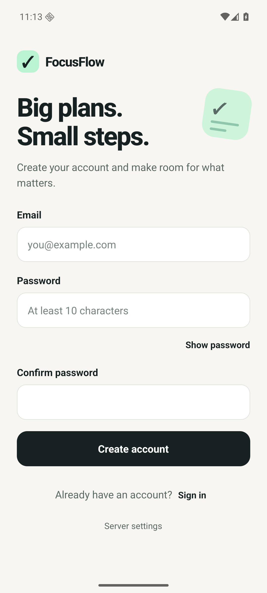
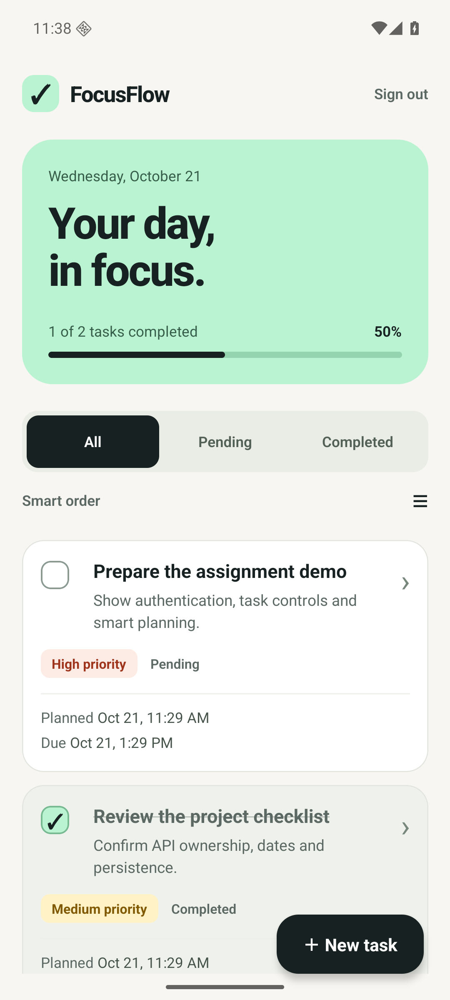
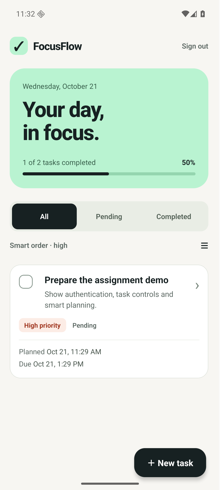
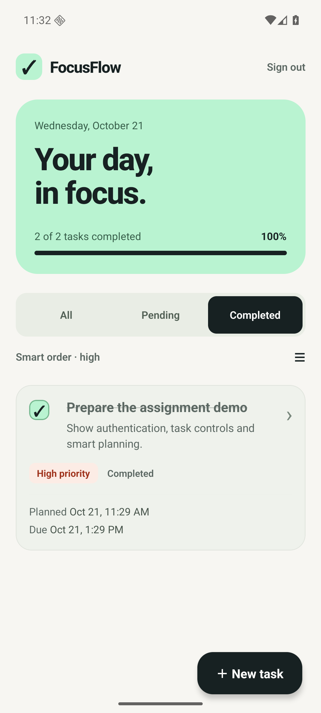
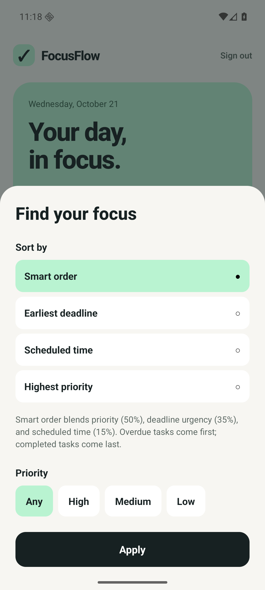

# FocusFlow

**A clearer day starts here.** An Android to-do app built with React Native CLI and TypeScript, backed by a Node.js/Express API and MongoDB.

Register, sign in, and manage your own tasks with schedules, deadlines, priorities, completion status, and smart sorting.

[Download APK](https://github.com/Kunal874/focusflow-todo/releases/download/v1.0.0-local.1/FocusFlow-local.apk) · [Watch/download demo](https://github.com/Kunal874/focusflow-todo/releases/download/v1.0.0-local.1/FocusFlow-demo.mp4) · [Release assets](https://github.com/Kunal874/focusflow-todo/releases/tag/v1.0.0-local.1) · [API documentation](docs/api.md)

> **Submission build: local evaluation.** The APK installs independently and bundles its JavaScript, so Metro is unnecessary. Login and task storage require the included API/MongoDB to run on a computer reachable from the Android device. There is no hosted backend. Follow the reviewer setup below before registering or signing in.

## Screenshots

Captured from the running Android app using synthetic test data.

| Sign in | Create account | Task dashboard |
| --- | --- | --- |
|  |  |  |

| Edit a task | Completed tasks | Smart sorting and filters |
| --- | --- | --- |
|  |  |  |

[View the full screenshot gallery](docs/screenshots/README.md), including native date/time pickers, validation, deletion confirmation, offline recovery, and enlarged-text layouts. [Download all 28 screenshots](https://github.com/Kunal874/focusflow-todo/releases/download/v1.0.0-local.1/FocusFlow-screenshots.zip).

## Features

- **Authentication:** email/password registration and login, password confirmation, validation, logout, secure session restoration, and readable errors.
- **Complete task workflow:** create, view, edit, complete, reopen, and confirm deletion. Each task has a title, description, scheduled date-time, deadline, and high/medium/low priority.
- **Persistent, separate workspaces:** users and tasks are stored in MongoDB; the API enforces task ownership using the authenticated user.
- **Smart sorting:** combines priority, deadline urgency, and scheduled-time urgency. Alternative sorts order by deadline, schedule, or priority.
- **Filters:** all/pending/completed status and priority, with completion progress and useful empty states.
- **Native Android experience:** native calendar/time pickers, keyboard-aware scrolling forms, accessible control labels, and retry after connection failures.

## Technology and architecture

| Layer | Implementation |
| --- | --- |
| Mobile | React Native **0.87**, Community CLI **20.2**, React **19**, TypeScript |
| Navigation and UI | React Navigation native stack, native date/time picker, custom shared controls |
| State | React Context, reducers, and derived filtering/sorting |
| Credential storage | `react-native-keychain`, backed by Android secure storage |
| API | Node.js **24**, Express **5**, TypeScript, Zod validation |
| Data | MongoDB with Mongoose |
| Authentication | Argon2id password hashes and verified one-hour JWT access tokens |
| Tests | Vitest/Supertest with disposable real MongoDB; Jest/React Native Testing Library |
| Automation | GitHub Actions: lint, TypeScript, tests, server build, standalone Android APK |

```text
Android app  ── HTTP /api + bearer token ──>  Express API  ──>  MongoDB
```

The API derives ownership from the verified token. Auth/task contexts handle loading, errors, retries, and session changes. Task changes appear after server confirmation; writes to the same task are queued in order. Session generations prevent delayed responses from appearing in another user's workspace.

## Reviewer quick start

### 1. Start the local API and database

Install **Node.js 24** and Git. Clone the repository and run:

```powershell
git clone https://github.com/Kunal874/focusflow-todo.git
cd focusflow-todo/server
npm ci
npm run dev:local
```

Leave this terminal running. The local runner:

- Downloads and starts a **real MongoDB binary** on first use; no Atlas account or separate MongoDB installation is needed.
- Generates a server-only JWT secret in the ignored `server/.env` file.
- Persists database files under the ignored `server/.local/mongodb` directory.
- Exposes the API on port **3000** and keeps MongoDB bound to loopback. If the preferred MongoDB port is occupied, it uses the managed instance's actual selected port.

First startup requires internet access for npm packages and the MongoDB binary. Run only one local runner against these database files.

Check the API in another terminal:

```powershell
Invoke-RestMethod http://127.0.0.1:3000/api/health
```

Expected response:

```json
{"status":"ok","database":"connected"}
```

For an existing MongoDB installation instead, use the configuration instructions in [docs/api.md](docs/api.md).

### 2. Install the APK and connect it

Download [**FocusFlow-local.apk**](https://github.com/Kunal874/focusflow-todo/releases/download/v1.0.0-local.1/FocusFlow-local.apk). It supports **Android 7.0/API 24 or newer**, with **arm64-v8a** and **x86_64** libraries. Android may ask you to allow installation from the app used to open the downloaded APK.

Alternatively, with Android SDK platform-tools and an emulator/USB device connected, run from the APK download folder:

```powershell
adb install -r .\FocusFlow-local.apk
adb shell am start -n com.focusflow.local/com.focusflow.MainActivity
```

Choose the appropriate connection in the app's **Server settings**:

| Device | API URL / setup |
| --- | --- |
| Standard Android Studio emulator on the backend computer | Default: `http://10.0.2.2:3000/api` |
| Android phone connected by USB | Run `adb reverse tcp:3000 tcp:3000`, then select the USB preset: `http://127.0.0.1:3000/api` |
| Phone on the same Wi-Fi/LAN | Enter `http://<computer-LAN-IP>:3000/api`. Allow port 3000 through the computer's firewall on the trusted local network. |

Keep the backend computer and API running. Changing the app's server address signs you out. A phone on an unrelated network cannot use this local backend without additional networking or hosting.

### 3. Try the assignment workflow

1. Create an account with your email and a **10–128 character** password; confirm it.
2. Add tasks with different priorities, schedules, and deadlines. A deadline cannot precede its scheduled time.
3. Edit a task, complete/reopen another, and delete one using the confirmation dialog.
4. Try status/priority filters and all four sort modes.
5. Restart the app to confirm secure session restoration and persisted tasks.
6. Sign out and create a second account to check that it has its own task list.

No shared demo credentials are needed; register a fresh account in your local database. Passwords are hashed on the server.

## Build the Android app from source

To compile rather than use the supplied APK, install **JDK 17**, Android SDK/build-tools **37.0.0**, platform **android-37.0**, NDK **27.1.12297006**, and CMake **3.22.1**. Configure `JAVA_HOME` and `ANDROID_HOME`. The [Windows setup guide](docs/windows-setup.md) records the tested tooling and emulator setup.

From the repository root, in a separate terminal from the running API:

```powershell
cd mobile
npm ci
npm run build:local -- -PreactNativeArchitectures=arm64-v8a,x86_64
```

Output: `mobile/android/app/build/outputs/apk/local/app-local.apk`.

On macOS/Linux, use `./gradlew assembleLocal -PreactNativeArchitectures=arm64-v8a,x86_64` inside `mobile/android` after installing the mobile dependencies and matching Android tools. Runtime testing for this assignment was performed on Windows/Android.

For development with Metro, run `npm start` inside `mobile`, then `npm run android` in another terminal there.

## Smart sorting

Smart mode puts **overdue pending tasks first** and **completed tasks last**. Other pending tasks receive a score:

```text
score = 50 × priorityWeight
      + 35 × deadlineUrgency
      + 15 × scheduledTimeUrgency
```

Priority weights are low = 1/3, medium = 2/3, high = 1. Deadline urgency increases over the next **72 hours**; scheduled-time urgency increases over the next **24 hours**. Both urgency values are clamped to 0–1. Ties use deadline, schedule, creation time, then ID. Completed tasks use most-recent completion first. Filtering and sorting do not mutate stored tasks. See the [design specification](docs/superpowers/specs/2026-10-21-focusflow-design.md) for details.

## Verification

The final local application passed **17 backend tests and 27 mobile tests**, both packages' ESLint/TypeScript checks, and the backend production build.

```powershell
cd server
npm run lint
npm run typecheck
npm test
npm run build
# With the local API already running in another terminal:
npm run test:live

cd ../mobile
npm run lint
npm run typecheck
npm test -- --runInBand
```

The backend suite uses disposable real MongoDB instances. The localhost smoke check verifies health, registration/login, persisted task CRUD, dates, completion/reopening, and two-user isolation using synthetic accounts.

The supplied APK was installed and tested on **Android 16/API 36, x86_64**, including secure restart restoration, logout, native pickers, account isolation, offline recovery, rejected sessions, small-screen/enlarged-text layouts, and activity recreation. APK signature, bundled JavaScript, both native ABIs, and checksum were verified. A **54-second demo** and **28 screenshots** are included in the release.

- [Detailed Android verification report](docs/android-verification.md)
- [GitHub Actions](https://github.com/Kunal874/focusflow-todo/actions/workflows/ci.yml)
- [Assignment requirements and evaluation walkthrough](docs/requirements.md)

## Project structure

```text
mobile/
  src/app/                 navigation and design tokens
  src/components/          shared controls
  src/features/auth/       forms, secure sessions, context/reducer
  src/features/tasks/      list, editor, state, sorting and validation
  src/lib/                 HTTP, server configuration and keychain helpers
  android/                 native Android app and build configuration
server/
  src/auth/                users, registration/login, validation and tokens
  src/tasks/               owner-scoped task model and routes
  src/middleware/          authentication and error handling
  scripts/                 persistent local MongoDB runner and smoke check
  tests/                   integration and startup regression tests
docs/                      API contract, screenshots, design and verification
.github/workflows/         package checks and standalone Android build
```

## Security and repository contents

- `.env` files, local databases, logs, generated APKs/build output, private release keys/certificates, and encrypted signing credentials are excluded from Git. `.env.example` contains placeholders only.
- The mobile app receives an access token; database credentials and JWT signing secrets stay on the server.
- Repository history was checked with **Gitleaks** before publication. The local JWT secret was also compared privately against historical Git blobs and was not found. Screenshots use synthetic data and do not display passwords or tokens.
- The standard Android **debug keystore** is intentionally included for reproducible local builds. It is a public development credential, not a production signing key. The supplied local APK uses this development key and permits HTTP for emulator/USB/LAN evaluation.
- Production builds enforce an HTTPS API URL and private signing environment variables; private signing material is not included in this submission.

## Known limits

- **Local backend required:** this submission has no hosted API. The APK alone cannot provide login/task storage while the backend is unreachable.
- Sessions expire after one hour and require a new login. Password recovery, email verification, immediate token revocation, offline writes, push reminders, pagination, and categories are outside this version.
- ARM64 libraries are included, but runtime testing used an x86_64 emulator. Physical ARM devices, TalkBack speech, and iOS were not tested.
- Docker Compose configuration validates; the container build was not exercised. Native local MongoDB development/testing was verified.
- The React Native/Metro/CLI build-tool tree has upstream npm audit advisories, including glob-pattern denial of service. Avoid untrusted build inputs; a forced dependency downgrade would break the selected native template. The server dependency audit reported no vulnerabilities at installation.

## Submission files

| Item | Link |
| --- | --- |
| Source code | [GitHub repository](https://github.com/Kunal874/focusflow-todo) |
| Android APK | [FocusFlow-local.apk](https://github.com/Kunal874/focusflow-todo/releases/download/v1.0.0-local.1/FocusFlow-local.apk) |
| APK SHA-256 file | [FocusFlow-local.apk.sha256](https://github.com/Kunal874/focusflow-todo/releases/download/v1.0.0-local.1/FocusFlow-local.apk.sha256) |
| Demo video | [FocusFlow-demo.mp4](https://github.com/Kunal874/focusflow-todo/releases/download/v1.0.0-local.1/FocusFlow-demo.mp4) |
| Screenshot ZIP | [FocusFlow-screenshots.zip](https://github.com/Kunal874/focusflow-todo/releases/download/v1.0.0-local.1/FocusFlow-screenshots.zip) |
| API contract | [docs/api.md](docs/api.md) |

SHA-256 of the supplied APK:

```text
ea5b0fc7b71a29c0e0703e5d5aae4a733c76cb7f5ed30f6f2b415266714d5659
```
