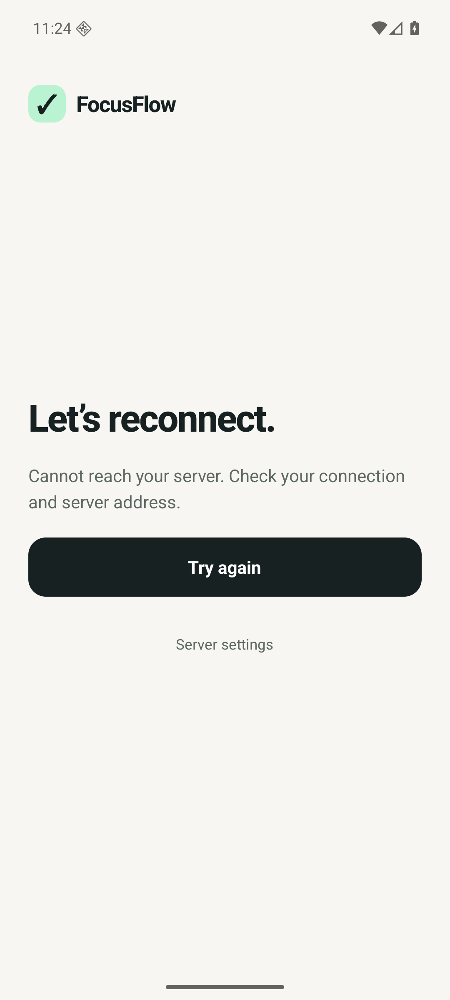
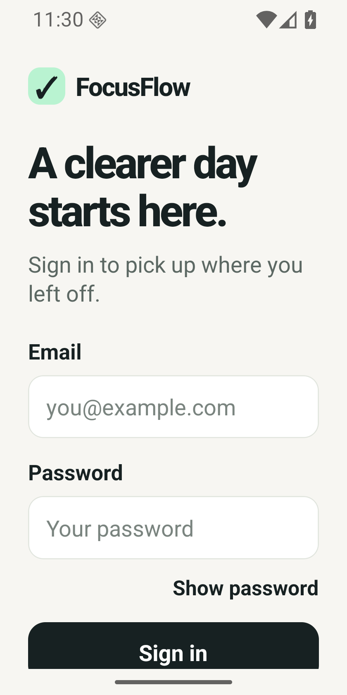

# FocusFlow screenshots

Captured from the real Android emulator during the local walkthrough. Test accounts use synthetic addresses. See the [verification report](../android-verification.md) for checks and limits.

| Sign in | Tasks | Edit task |
| --- | --- | --- |
|  |  |  |

| Sort and filter | Offline recovery | Smaller screen with enlarged text |
| --- | --- | --- |
|  |  |  |

Other numbered images record validation, native date/time pickers, completed tasks, deletion confirmation, account isolation, session restoration and small-screen scrolling. Earlier walkthrough screenshots show the same application flow; the final gallery task and sorting images use the final APK.
